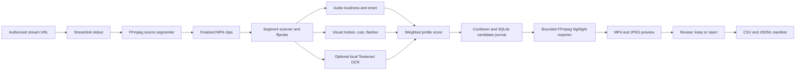

# LiveClip Zero Smart — Architecture & acceptance contract

## End-to-end flow



## Processing boundaries

- **Capture:** a pair of child processes for Streamlink and FFmpeg; a thread monitors liveness, disk free space, and restart attempts. FFmpeg stream copy avoids costly continuous transcoding.
- **Segment finalization:** the newest MP4 is not analyzed until its successor appears or recording stops. Corrupted or truncated files are reported instead of accepted as evidence.
- **Signals:** FFmpeg decodes 2 FPS grayscale frames at 160×90 (fixed upper memory bound per segment), plus 8kHz mono PCM audio. Per-second novelty scores consider loudness above per-segment median, audio attack, frame mean absolute difference, scene jumps, and brightness jumps. A named profile provides weights. OCR is a separate opt-in Tesseract subprocess at bounded sample positions.
- **Candidates:** each 30/60s segment provides up to three local peaks, excluding peaks within eight seconds in the segment. A SQLite entry is keyed by epoch and candidate event time and excludes near-duplicates within a configurable cooldown. Scores are deterministic and human-reviewable, not neural model outputs.
- **Export:** the renderer assembles only adjacent finalized source segments from the *same reconnect epoch* via FFmpeg's concat demuxer; extracts a 15/30/45/60s H.264/AAC highlight with configurable pre-roll (40%) and post-roll (60%), adjusted near session start/end; then atomically renames the completed output. It generates a JPEG preview best-effort.
- **Metadata:** SQLite is canonical. Review statuses and scores materialize to a JSONL manifest plus a CSV review list. The reports are regenerated during resume and at shutdown, and every 20 exports while capture is active.
- **Privacy:** all media analysis is local; no network upload, provider accounts, paid LLMs, telemetry, or cloud recognition APIs.

## State machine

```text
capture: idle -> connecting -> recording -> finalizing -> finished
                                      |-> reconnecting -> recording
analysis: idle -> scanning -> candidate_pending -> rendering -> exported
                                      |-> error (recorded, preserved)
review: unreviewed -> keep | reject (never auto-delete output)
```

## Controls and error handling

- `capture stop` closes upstream and gives FFmpeg time to finalize source files, then signals analysis drain.
- A network reconnect leaves an epoch gap marker. No highlight can cross that marker.
- The analyzing worker stays independent of source capture: errors in candidate extraction do not terminate the capture thread.
- FFmpeg commands are argument lists, **never shell-concatenated**; paths are ffconcat-quoted, and video inputs are processed as files, not executable content.
- Source clips aren't automatically deleted and review Reject never destroys files. Crash recovery uses SQLite WAL and atomic output rename.
- Timeouts bound individual subprocesses; frame/audio downsampling reduces expensive full-resolution processing.
- Scheduled processing is opportunistic and bounded by local CPU, disk and I/O throughput, not a guaranteed real-time deadline.

## Known limits and future hardening

1. **Semantic understanding:** no model reliably recognizes jokes, kills, amazing chess moves, game-specific UI, facial emotion, or audience sentiment. OCR triggers can match false positives. Optional locally hosted models would increase CPU/RAM requirements and require separate benchmarks.
2. **Precision/recall:** the detector has **no labeled benchmark dataset** or measured quality metrics. Scores are heuristic, not calibrated probabilities. It needs per-genre acceptance testing against real authorized streams.
3. **24/7 SLA:** no 24-hour stress/soak test, disk-failure simulation, system-sleep automation or watchdog service has been run. Scaling to hundreds of thousands of segments needs directory sharding/retention policy and sampled monitoring.
4. **Provider compatibility:** Streamlink-supported sources only. Live YouTube/Twitch platform integration has not been tested here.
5. **Resource pressure:** if many signals trigger, each exported clip adds disk usage and H.264 encoding load. Tuning threshold/cooldown reduces duplicates; user remains responsible for disk retention.
6. **Disconnected sources:** no cross-outage splicing. Clock seconds are based on accumulated durations of valid segments, not wall-clock broadcast time; UI's session-second values are approximate.
7. **Windows/macOS UX:** native GUI, terminal scripts and Tesseract PATH need testing on real machines before claiming installer-grade release.

## Release gate checklist

| Gate | Current evidence |
|---|---|
| Python modules compile | PASS |
| Deterministic audio/visual scoring synthetic cases | PASS |
| No-audio input | PASS |
| OCR with local synthetic text and Tesseract (Linux) | PASS |
| SQLite candidate de-duplication, update and restart | PASS |
| Concat handling of apostrophe and Unicode path | PASS |
| Finalized MP4 export and review metadata | PASS |
| Captured synthetic transport stream -> actual Recorder -> highlights | PASS |
| FFmpeg baseline source segmenter test | PASS |
| Real public YouTube / Twitch end-to-end | UNVERIFIED |
| Windows / macOS GUI acceptance | UNVERIFIED |
| One-day soak test and alerting | UNVERIFIED |
| Human-reviewed precision/recall benchmark | UNVERIFIED |

## Repository boundaries (v2.1)

`src/liveclip/` is the single importable runtime package; `tests/` contains synthetic offline tests. External command-line binaries are not vendored. Process-scoped recording and analysis threads are deliberately separated from GUI updates through a queue. SQLite is the only durable state. No background daemon/server is installed.

Security boundaries: only explicit user-provided URLs, subprocess commands as argument arrays (never shell=True), bounded offline media analysis, no arbitrary remote uploads or external AI requests. Untrusted media and upstream tools remain a dependency risk; keep binaries patched.
